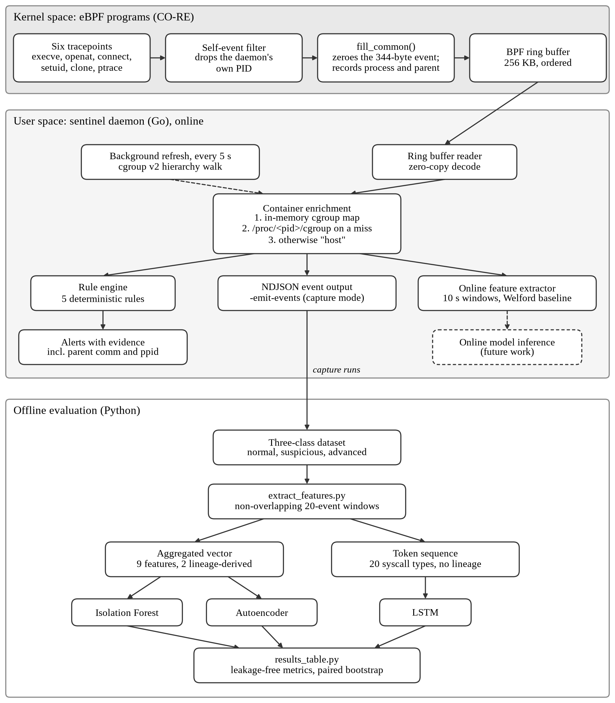

# sentinel-eBPF

Kernel-level syscall telemetry and unsupervised anomaly detection for Linux containers.

eBPF tracepoints >> Go concurrent pipeline >> offline three-model comparison >> explainable rule-based alerts.

CI: passing · License: Apache 2.0 · Kernel >= 5.8 · Go 1.22

--- >< ---

## What this is

sentinel-eBPF is the artefact of an honours research project. It asks a single question: when container syscall telemetry is collected with eBPF, which behavioural representation detects attacks better, an aggregated feature vector or an ordered syscall sequence?

To answer it, the system captures syscall telemetry through six eBPF tracepoints, including parent-child process lineage, processes events concurrently in a Go daemon, raises rule-based alerts online, and writes events to disk for an offline comparison of three unsupervised models.

The honest headline of the result is not a model leaderboard. It is this: detection rested almost entirely on process lineage features, not on syscall ordering. Removing the two lineage-derived features dropped detection to below chance. The full result, including what this means and what it does not, is in the research summary below.

Status: complete. All builds finished. Results locked and reproducible from the scripts in `ml/`.

--- >< ---

## Research summary

Title: Evaluation of Unsupervised Anomaly Detection on eBPF-Based Container Syscall Telemetry
Supervisor: Mr. S. M. Makura, University of Pretoria
Module: COS700 Honours Research Project, 2026

### The comparison

Three unsupervised models were trained on normal behaviour only and evaluated on unseen suspicious and advanced behaviour, under a leakage-free protocol. The normal class was split into training, threshold calibration, and false-positive test sets. All metrics are computed on 1884 unseen windows. Inference uses a paired, class-stratified bootstrap (B = 2000).

| Model | Representation | AUC [95% CI] | FPR | F1 (1:1) |
|-------|----------------|--------------|-----|----------|
| Isolation Forest | aggregated | 0.767 [0.731, 0.804] | 0.040 | 0.195 |
| Autoencoder | aggregated | 0.782 [0.758, 0.805] | 0.025 | 0.572 |
| LSTM | sequence | 0.731 [0.698, 0.763] | 0.094 | 0.440 |

Both aggregated models outperformed the sequence model overall. The neural and non-neural aggregated models were statistically indistinguishable. On the advanced class specifically, all three models were statistically indistinguishable, so the pre-registered hypothesis that ordering improves advanced-attack detection was not supported.

### What actually drove detection

A lineage ablation retrained the two aggregated models without their two lineage-derived features (shell-parent spawns and distinct-parent count). Overall AUC fell from 0.782 to 0.298 for the Autoencoder and from 0.767 to 0.454 for the Isolation Forest. Both fell below chance. Every bootstrap interval excluded zero.

The comparison therefore did not isolate ordering. It compared a representation carrying process lineage against one that did not. The supported claim is narrow and honest: the representation carrying lineage detected better than the representation without it. Whether ordering helps once both representations carry the same information is open, and is the first item of future work.

### Honest caveats

- The per-second rate features encoded the tempo of the capture scripts rather than behaviour. A 20-event window spanned a median of 16 ms for normal workloads and about 750 ms for the attack workloads.
- Two of the nine features were inert. `privileged_syscall_count` was always zero because the event serialisation dropped the new-UID field when it was zero. `ptrace_count` was always zero because no ptrace occurred in the captures.
- Evaluation used a self-generated dataset on a single node. Sub-2 percent overhead was not confirmed on dedicated hardware.
- Lineage features may partly reflect workload structure, since the normal workload was dominated by one long-lived process. This is untested on benign workloads that spawn many short-lived processes.

--- >< ---

## System architecture



The online daemon captures, enriches, computes feature vectors, and raises rule-based alerts. The three models run offline on captured events. Lineage reaches the aggregated feature vector and the alert evidence, but never the token sequence.

--- >< ---

## How it works

### Layer 1 >> Linux kernel (C, libbpf, CO-RE)

Six eBPF tracepoints capture syscall activity across container namespace boundaries. CO-RE means one compiled object loads across kernel versions without recompilation.

| Tracepoint | Fields captured | Relevance |
|------------|-----------------|-----------|
| sys_enter_execve | pid, ppid, comm, parent_comm, filename, cgroup_id | Shell spawns, recon tools, process chains |
| sys_enter_openat | pid, filename, cgroup_id | Host-namespace access, credential paths |
| sys_enter_connect | pid, dest_ip, dest_port, cgroup_id | Outbound connections, port scans |
| sys_enter_setuid | pid, uid, new_uid, cgroup_id | Privilege escalation to UID 0 |
| sys_enter_clone | pid, clone_flags, cgroup_id | Namespace creation |
| sys_enter_ptrace | pid, ptrace_request, cgroup_id | Process inspection |

The event struct is zeroed per event (a ring-buffer slot is not cleared on reserve), and the daemon's own events are dropped in-kernel by PID filter so the tool does not observe itself. Parent fields come from the kernel task_struct via BPF_CORE_READ.

Note from the evaluation: in the captured data, execve, openat, connect and setuid appeared in all classes; clone appeared only in normal behaviour; ptrace never fired.

### Layer 2 >> Go daemon (cilium/ebpf)

Goroutines connected by typed channels read the ring buffer, enrich events with container identity, compute feature vectors, and run the rule engine. Container identity is resolved map-first: an in-memory cgroup map refreshed every five seconds, with a per-process `/proc/<pid>/cgroup` read only on a miss.

The daemon raises alerts from five deterministic rules. It does not run the ML models. Online model inference is future work.

### Layer 3 >> Offline evaluation (Python)

Events written in capture mode feed `ml/extract_features.py`, which emits both representations from the identical event stream over non-overlapping 20-event windows: a nine-feature aggregated vector and a 20-token syscall sequence. The three models and the full evaluation are driven by the scripts in `ml/`.

The nine aggregated features: execve rate, connect rate, file-open rate, process-spawn rate, privileged-syscall count, ptrace count, shell-parent spawn count, shell-after-connect count, and distinct-parent count. The last three encode security context; the two inert features noted above are among the nine.

### Explainable alerts

A rule-based alert reports the rule, severity, container, a description, and an evidence set that includes the offending process, its parent command, and its parent PID. Verified on a live container-escape trigger:

```
[ALERT] CRITICAL | CONTAINER_ESCAPE | <container> | opened /proc/1/ns/pid |
  evidence={"filename":"/proc/1/ns/pid","parent_comm":"sh","pid":7368,"ppid":7362}
```

The alert gives a responder the process lineage of an event rather than a bare identifier. Integrating the per-container baseline deviation directly into the alert is future work.

--- >< ---

## Runtime performance

Overhead was profiled on the development machine and reduced from 8.4 percent to 3.4 percent of system CPU through four fixes, each found with a named tool and measured before and after.

| Fix | Found with | Effect |
|-----|-----------|--------|
| Kernel self-event filter | pidstat | idle CPU 67.6% to 1.3% |
| Cache-miss walk removal | strace | removed tens of thousands of directory reads per second |
| Map-first enrichment | perf | removed a per-event /proc read |
| Zero-copy event decode | perf | removed reflection-based deserialisation, the top user-space cost |

The residual 3.4 percent is dominated by Go runtime garbage collection and scheduler contention on shared hardware, not by the instrumentation. Sub-2 percent is assessed as achievable but was not confirmed; dedicated-hardware benchmarking is future work.

--- >< ---

## Evaluation design

Models train on normal behaviour only. Suspicious and advanced windows are evaluation-only.

| Class | Description | Examples |
|-------|-------------|----------|
| Normal | Legitimate multi-process workload | subprocess spawns, file reads and writes, outbound calls to an internal service |
| Suspicious | Legitimate tools on illegitimate targets | reading /etc/shadow and /root/.ssh, enumerating setuid binaries, privilege recon |
| Advanced | Attack patterns, no live exploits | nested shell chains, reverse-shell connect-then-spawn, setuid escalation, setuid-binary planting |

Dataset: 3027 windows total, 1345 normal, 699 suspicious, 983 advanced. Metrics: AUC, per-class AUC, precision, recall, F1 at 1:1 prevalence, and false-positive rate, per model. Datasets are regenerated by the capture scripts in `scripts/`, not stored in the repository.

--- >< ---

## Reproducing the results

Prerequisites: Linux kernel >= 5.8, Go 1.22+, clang/LLVM, Docker, Python with numpy, pandas, scikit-learn, scipy, torch.

```bash
git clone https://github.com/Murashidzi/sentinel-ebpf.git
cd sentinel-ebpf

# build the eBPF object and the daemon
cd daemon && go generate ./... && go build -o sentinel . && cd ..

# capture the three behavioural classes (writes to evaluation/datasets/)
sudo scripts/capture_normal.sh 360
sudo scripts/capture_suspicious.sh 360
sudo scripts/capture_advanced.sh 360

# extract both representations, train and score the models, then the results
python3 ml/extract_features.py
python3 ml/train_isolation_forest.py
python3 ml/train_autoencoder.py
python3 ml/train_lstm.py
python3 ml/results_table.py        # the single source of truth for every reported number
python3 ml/ablation_lineage.py     # the RQ3 lineage ablation
python3 ml/make_figures.py         # Chapter 5 figures
```

To run the live daemon and see rule-based alerts:

```bash
sudo daemon/sentinel            # alerts to stderr
sudo daemon/sentinel -emit-events   # also writes per-event JSON for capture
```

--- >< ---

## Repository layout

```
sentinel-ebpf/
├── kernel/
│   ├── tracer.bpf.c              eBPF programs (C, libbpf, CO-RE)
│   └── headers.h                 shared event struct
├── daemon/
│   ├── main.go                   pipeline orchestration
│   ├── enricher.go               cgroup map-first container enrichment
│   ├── feature_extractor.go      online feature vectors (printed)
│   ├── rule_engine.go            five deterministic rules, alert evidence
│   └── tracer_bpf*.go            bpf2go bindings
├── ml/
│   ├── extract_features.py       both representations from one event stream
│   ├── train_isolation_forest.py
│   ├── train_autoencoder.py
│   ├── train_lstm.py
│   ├── results_table.py          leakage-free metrics and paired bootstrap
│   ├── ablation_lineage.py       RQ3 lineage ablation
│   ├── make_figures.py           result figures
│   └── make_diagrams.py          architecture and design figures
├── evaluation/datasets/          gitignored; regenerated by scripts
├── scripts/
│   ├── capture_normal.sh
│   ├── capture_suspicious.sh
│   ├── capture_advanced.sh
│   └── measure_overhead.sh
├── docs/uml/                     diagrams
└── LICENSE                       Apache 2.0
```

--- >< ---

## Technology stack

| Layer | Technology |
|-------|-----------|
| Kernel instrumentation | C, libbpf, CO-RE, clang/LLVM |
| User-space daemon | Go 1.22, cilium/ebpf |
| Offline models | Python, PyTorch (Autoencoder, LSTM), scikit-learn (Isolation Forest) |
| Evaluation | numpy, pandas, scipy, matplotlib |
| Profiling | pidstat, strace, perf |
| CI | GitHub Actions |

--- >< ---

## License

Apache 2.0. See LICENSE.
