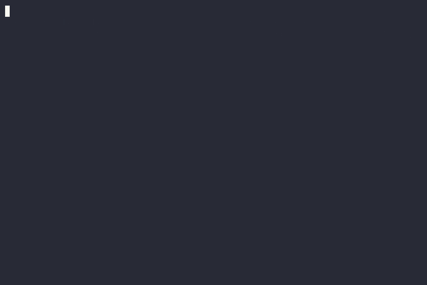
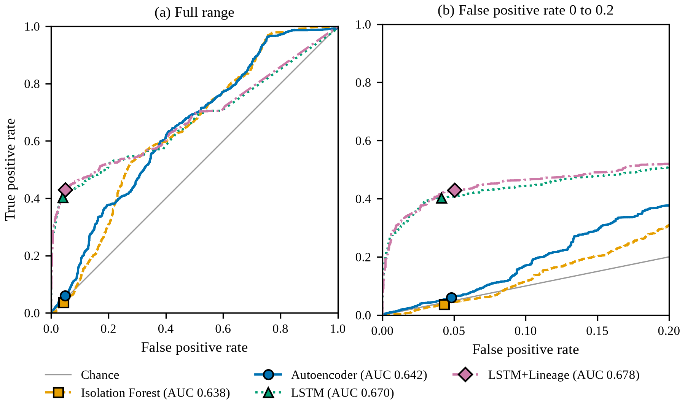

# sentinel-eBPF

**On container system-call telemetry captured with eBPF, a model that reads the *order* of system calls detected advanced attack behaviour far better than models that summarise them. Adding process lineage on top made almost no difference.**



*60-second live run. The daemon attaches six eBPF tracepoints, then flags a container-escape pattern and a port scan. Every alert names the parent process that caused it.*

---

## The result

Four unsupervised models were trained on normal behaviour only. They were tested on capture runs they never saw: no test window shares a run with any training window.

| Model | Input | AUC, normal vs advanced-like | Advanced-like windows caught at about 5% false alarms |
|---|---|---|---|
| LSTM + lineage | ordered sequence + parent info | 0.726 | 51.8% |
| LSTM | ordered sequence | 0.715 | 49.1% |
| Autoencoder | 9 summary features | 0.640 | 6.4% |
| Isolation Forest | 9 summary features | 0.621 | 3.1% |

Both LSTMs beat both summary models (paired bootstrap, B = 2000, every 95% interval excludes zero). Lineage adds about 0.01 AUC to the LSTM: real, but too small to matter.



### Why the answer changed

An earlier evaluation on a narrower dataset showed the opposite: the summary models led. A lineage ablation traced that lead to a shortcut. The normal workload was one long-lived process, so parent-process features separated it from attacks trivially. Three fixes reversed the ranking: a benign shell-heavy normal workload, a corrected serialisation bug, and a split that holds out whole capture runs.

### Limits

- Constructed workloads on one laptop, 12 capture runs. Not real attacks, not production traffic.
- AUCs are moderate (0.62 to 0.73). At one attack window per hundred, about nine in ten LSTM alarms would be false. These models fit as a scoring layer next to rules, not as a standalone detector.
- The models run offline on captured events. The live daemon raises rule-based alerts only.
- Daemon overhead was 3.4% of system CPU on development hardware. The 2% target was not met.

---

## How it works


**Kernel (C, libbpf, CO-RE).** Six tracepoints (execve, openat, connect, setuid, clone, ptrace) record each call with its process, parent PID and parent command. The daemon's own events are dropped in-kernel. A counter records events lost when the 256 KB ring buffer is full: zero in four verification runs of the dataset workloads.

**Daemon (Go, cilium/ebpf).** Attributes each event to its container, map-first, then runs five deterministic rules. Each alert carries the process lineage as evidence.

**Offline evaluation (Python).** Captured events are cut into 20-event windows. Each window becomes a 9-feature summary vector, a syscall-type sequence, and a sequence with two lineage channels. Four models score them: Isolation Forest, Autoencoder, LSTM, and LSTM + lineage.

---

## Run it

Requires Linux kernel 5.8 or later with BTF, Go 1.22, clang, Docker, and Python with numpy, scikit-learn, scipy, torch and matplotlib.

**Live demo** (the container is deliberately privileged to simulate escape conditions):

```bash
git clone https://github.com/Murashidzi/sentinel-ebpf.git && cd sentinel-ebpf
cd daemon && go generate ./... && go build -o sentinel . && cd ..
sudo -v && bash scripts/demo.sh
```

**Reproduce the evaluation:**

```bash
sudo -v && bash scripts/capture_all.sh 180    # 12 capture runs, about 40 minutes
python3 ml/extract_features.py
python3 ml/train_isolation_forest.py && python3 ml/train_autoencoder.py
python3 ml/train_lstm.py && python3 ml/train_lstm_lineage.py
python3 ml/results_table.py       # window-level split
python3 ml/eval_run_level.py      # run-level split (primary)
python3 ml/ablation_lineage.py    # lineage ablation
python3 ml/make_figures.py && python3 ml/make_diagrams.py
```

Capture timing varies between runs, so a fresh capture gives close but not identical numbers. Exact numbers reproduce only from the same capture files.

---

## Repository layout

```
kernel/    tracer.bpf.c, headers.h          eBPF programs
daemon/    main.go, enricher.go,            pipeline, container attribution,
           rule_engine.go,                  rules, online features
           feature_extractor.go
ml/        extract_features.py              windows and three representations
           train_*.py                       four models
           results_table.py                 window-level metrics, bootstrap
           eval_run_level.py                run-level split (primary)
           ablation_lineage.py              lineage ablation
           make_figures.py, make_diagrams.py
scripts/   capture_*.sh, capture_all.sh     dataset capture
           demo.sh                          the recorded demo
docs/      demo.gif, figures, diagrams
```

---

COS700 Honours research, University of Pretoria, 2026. Supervisor: Mr S. M. Makura. Apache 2.0.
